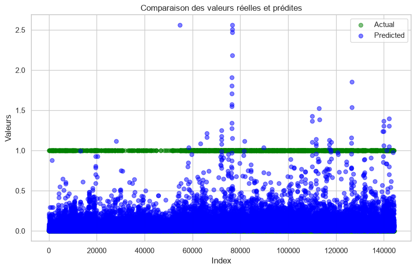
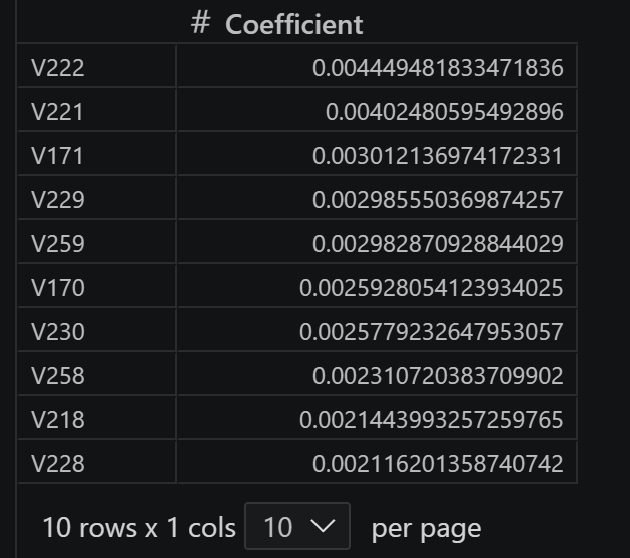

# Projet 1: Détection de fraude (modélisation)
- Données : IEEE-CIS Fraud Detection from Kaggle
- Objectifs: Prédire la probabilité qu'une transaction en ligne soit frauduleuse.
- Livrable : Notebook + fichiers pdf expliquant la démarche, les résultats obtenus ainsi qu'une synthèse et possibilité d'amélioration.

## Données
Pour ce projet nous allons utilisé la base de données de IEE-CIS Fraud Detection from Kaggle, qui regroupent des transacation e-commerce réelles de Vesta et contiennent un large éventail de fonctionnalités allant du type d'apppareil aux caractéristiques du produit.

Les données sont séparées en 2 fichiers rejoint par un '.' . Toutes les transactions n'ont pas d'informations d'identité correspondantes.
La table transaction contient des transferts d'argent de cadeaux et de services.
La table identity contient des informations d'identité, de connexion réseau associées aux transacations.
## Informations générales sur les fichiers de données
Il existe différentes type de caractéristiques : 

- Caractéristiques catégorielles - Transaction: productid,card1-card6,addr1,addr2,P_emaildomain,R_email_domain,M1 - M9
- Caractéristques catégorielles - Identité: DeviceType,DeviceInfo,id_12 - id_38

La cararctéristiques est une différence de temps à partir d'une data-heure de reférence donnée(et non un horodotage réel). TransactionDT.

**Dossier**
- train_{transaction,identité}.csv : ensemble d'entraînement
- test_{transaction,identité}.csv : ensemble de test à utiliser pour prédire la valeur des observations
- sample_submission.csv: fichier de soumission d'exemple dans le format correct
#### Table Transaction
- TransactionDT : delta temporelle d’une date de référence donnée (et non d’un horodatage réel)
- TransactionAMT : montant du paiement de la transaction en USD
ProductCD : code produit, le produit pour chaque transaction
- Carte1 - Carte6 : informations sur les cartes de paiement, telles que le type de carte, la catégorie de carte, la banque d’origine, le pays, etc.
- ADDR : Adresse
- dist : distance
- P_ et (R__) domaine email : domaine email acheteur et destinataire
- C1-C14 : comptage, comme le nombre d’adresses identifiées à la carte de paiement, etc. Le sens réel est masqué.
- D1-D15 : delta de temps, comme les jours entre les transactions précédentes, etc.
- M1-M9 : correspondance, comme les noms sur la carte et l’adresse, etc.
- Vxxx : Vesta a conçu des fonctionnalités riches, y compris le classement, le comptage et d’autres relations avec les entités.

#### Table Identity
Caractéristiques catégorielles : DeviceType DeviceInfo id_12 - id_38

## Déroulé du travail
L'objectif est d'entraîner des modèles d'apprentissage automatique afin de prédire la probablité d'une transaction en ligne soit frauduleuse. Pour ce faire on va appliquer les étapes suivantes:
- *Pré-traitement des données*: nettoyage, modélisation des données,feature engineering,m
- *Analyse statistique des données*: comprendre comment les données sont liés entre elles 
- *Entrainment des modèles d'apprentissage automatique*
- *Evaluation des modèles* avec les métriques dédiés
- *Choix du modèle* ayant les meilleurs résultats et *Test des performances*
- Conclusion et perspcetive

## Conclusion du projet 
On a reussi à entraîner un modèle de regression logistique qui nous permet de prédire la probablité qu'une transaction en ligne soit frauduleuse ou pas.  

Les variables les plus importantes pour comprendre le phénomène de transactaion frauduleuses sont les variables suivantes

Avec une erreur moyenne de 0.06, et une erreur moyenne absolue de 0.13 notre modèle arrive à prédire des probabilité qui correspondent aux valeurs réelles.Mais le modèle n'explique pas la variabilité de notre variables dépendante, avec un R acrré de 0.18, il se contente juste de prédire la moyenne.

Les principaux challenges de ce projet on été au niveau de la compréhension de la  base de donnée, et du déséquilibre au niveau des classes fraud or not fraud. Pour avoir des résultats plus performants et un modèle utilisable avec un plus grand seuil de confiance, il serair pertinent de commencer par expliciter l'interprétentation de chaque colonne. Chaque colonne doit être justifié et correspondre à des informations précises, ensuite il faudrait gérer le problème de déséquilibre des classes. Pour cela différentes méthodes peuvent être appliquées comme le rééchantillonage (le suréchantillonage, sous_échantillonage).